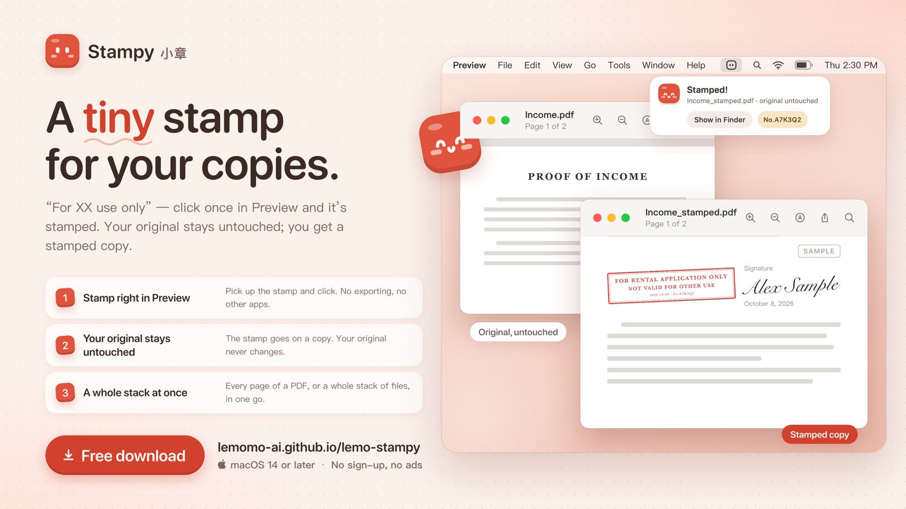
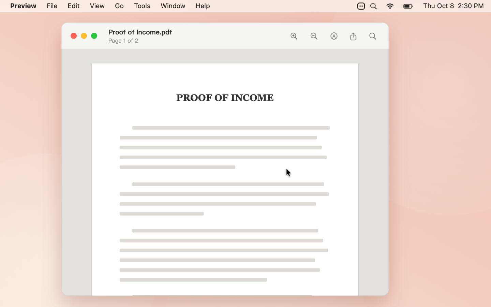
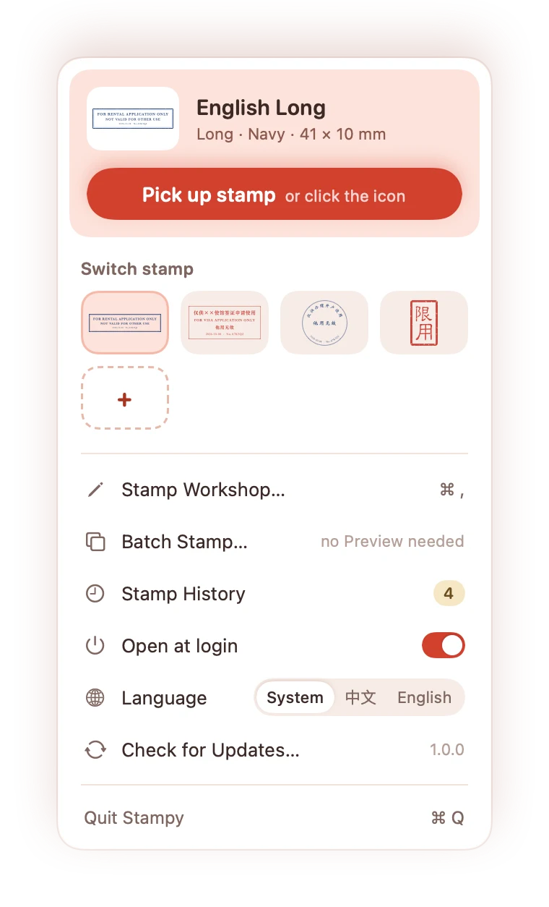
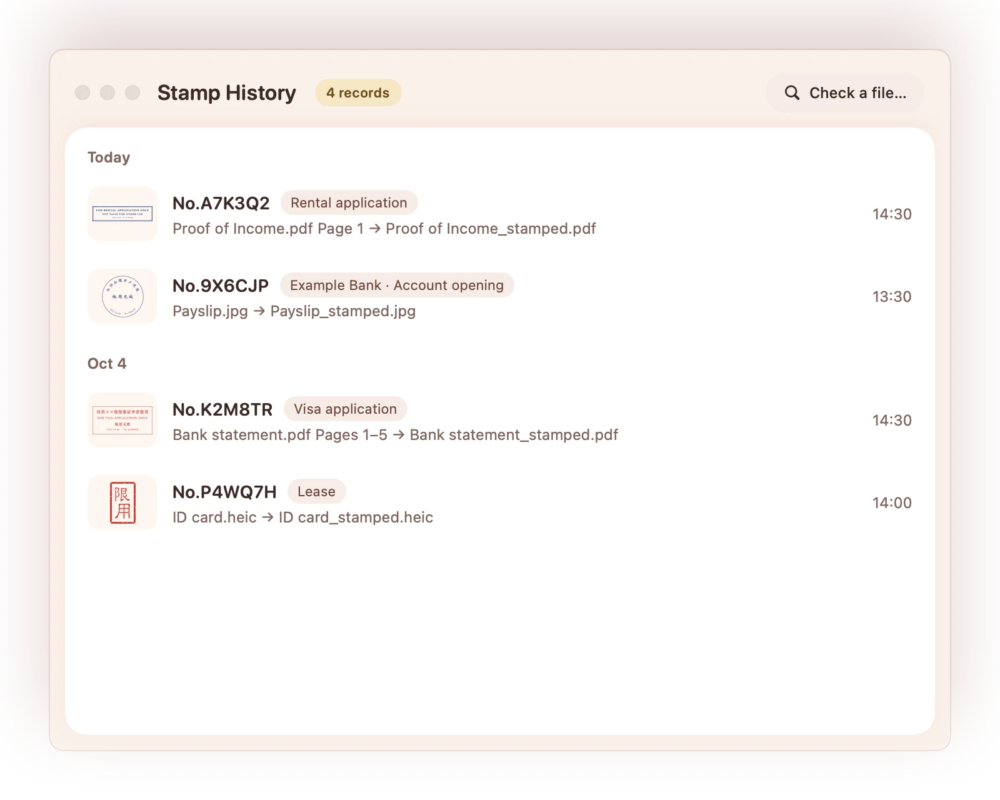

<div align="center">


# Stampy · 小章

**A tiny stamp for your copies.**<br>
**给复印件，盖个小小的章。**

A little helper that lives in your Mac's menu bar: click once in Preview to stamp "For XX use only" on a copy.<br>
住在 Mac 菜单栏里的小工具：在预览里点一下，给文件副本盖上“仅供××使用”。



[**⬇ Download Stampy 1.0 · 下载小章 1.0**](https://github.com/lemomo-ai/lemo-stampy/releases/latest/download/Stampy.dmg)
&nbsp;·&nbsp;
[**Website · 网站**](https://lemomo-ai.github.io/lemo-stampy/)

**English** | [中文](README.zh-CN.md)

    

</div>

> **中文用户请看这里：[完整中文说明 README.zh-CN.md](README.zh-CN.md)**<br>
> English readers: keep reading below.

## What it does · 它做什么

"For XX use only" — click once in Preview and it's stamped. Your original stays untouched; you get a stamped copy. Free and open source, no sign-up, no ads.<br>
在预览里点一下，就盖上“仅供××使用，他用无效”。原件不动，另存一份。免费开源，不用注册，没有广告。

Visas, bank accounts, rental applications — they all ask for copies of your documents. But a copy can be reused for things you never agreed to. Stamp "For XX use only" on it, and that copy is good for one purpose only.<br>
办签证、开银行账户、租房，都要交一沓证件复印件。可复印件一交出去，就可能被挪作他用。盖上“仅供××使用”，这份复印件就只能用在这件事上。

## Download

**[Download Stampy 1.0](https://github.com/lemomo-ai/lemo-stampy/releases/latest/download/Stampy.dmg)** (2.5 MB, signed and notarized by Apple).

Open `Stampy.dmg` and drag Stampy into Applications. Open it, and it moves into your menu bar.

## How it works

<p align="center">
  
</p>

1. **Pick up the stamp.** Click Stampy in the menu bar and the stamp follows your pointer.
2. **Click where it goes.** Move over a PDF or photo open in Preview, scroll to resize, and click. The stamp always stays fully on the page.
3. **Save a copy.** Confirm, and it's saved as a "_stamped" copy. Your original never changes.

## What else it does

- **A whole stack at once.** Drag files — or a whole folder — onto Stampy in the menu bar and stamp them all in one go.
- **Every page of a PDF.** Choose "Every page" and the stamp lands in the same spot on each one. Tap a thumbnail to skip a page.
- **Small and neat.** Long stamps are about 35 mm, round ones 22 mm, square seals 7 mm — they fit beside a signature without covering anything.
- **Make your own.** 17 templates in the stamp workshop: round, square or long, in Chinese or English.
- **Every stamp has an ID.** A date and ID on every stamp, so you know which copy went where.
- **Password-protected PDFs, too.** Enter the password once; the stamped copy is locked with the same password, which is never saved.

<p align="center">
  
  &nbsp;
  
</p>

## Privacy

Everything happens on your Mac — reading the page, drawing the stamp, saving the copy. Your files are never uploaded anywhere, and your stamp history stays on your own computer.

The full source code is in this repository, so you can check this yourself.

Stampy only goes online when you click "Check for Updates…", to see if there's a new version. It only reads a public [`version.json`](https://lemomo-ai.github.io/lemo-stampy/version.json), sends no identifiers, collects nothing, and never installs anything by itself.

## Requirements

macOS 14 Sonoma or later, on Apple silicon or Intel.

The first time, Stampy walks you through turning it on in **System Settings › Privacy & Security › Accessibility**. It only uses this to see which file is open in Preview and where you clicked.

## What the stamp is

It's your own note on what a copy may be used for — like writing "for rental application only" across it by hand, just neater.

## Feedback

Found a bug or have an idea? Open an [issue](https://github.com/lemomo-ai/lemo-stampy/issues). Your macOS version and what you did before the problem help a lot. Pull requests are welcome too; for bigger changes, please open an issue first so we can talk it through.

## Build from source

You need macOS 14 or later, Xcode (tested with Xcode 26), and [XcodeGen](https://github.com/yonaskolb/XcodeGen) (`brew install xcodegen`).

```sh
./scripts/build.sh               # build, install to ~/Applications and launch
./scripts/build.sh --no-install  # build only, into build/小章.app
./scripts/test.sh                # unit tests, build, screenshot checks
```

Local builds are ad-hoc signed, so macOS may ask you to turn Accessibility on again after each rebuild. The stamping engine lives in `Core/` (a Swift package with its own tests); the menu bar app is in `App/`, and the website is in `website/`.

## License

[MIT](LICENSE). Free to download, use, change and share.

<p align="center"><sub>Stampy. A small stamp, for peace of mind. · LemoLab</sub></p>
