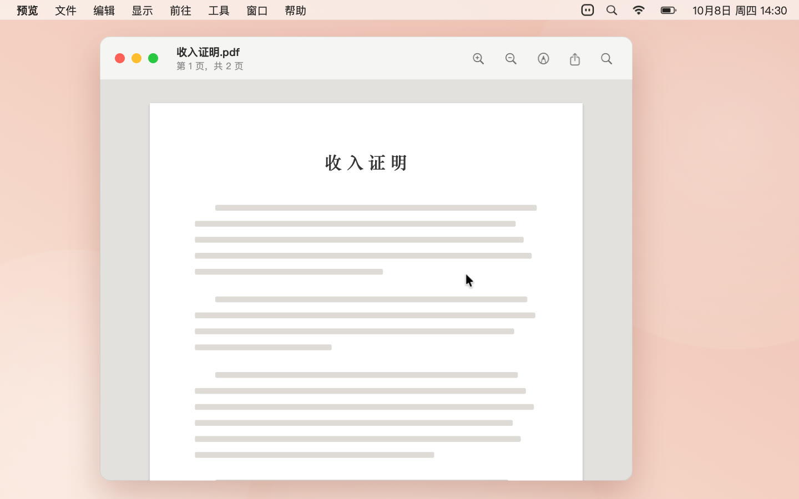
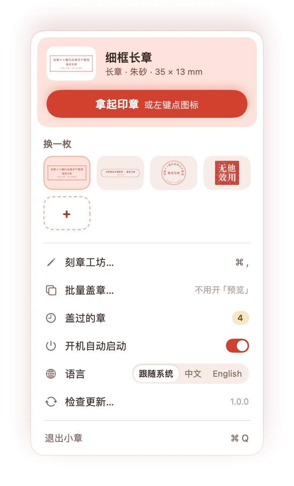
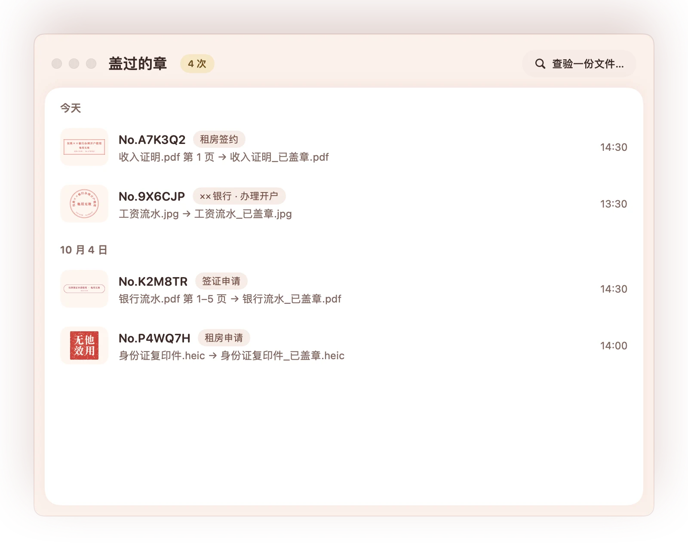

<div align="center">


# 小章 · Stampy

**给复印件，盖个小小的章。**<br>
**A tiny stamp for your copies.**

住在 Mac 菜单栏里的小工具：在预览里点一下，给文件副本盖上“仅供××使用”。<br>
A little helper that lives in your Mac's menu bar: click once in Preview to stamp "For XX use only" on a copy.


[**⬇ 下载小章 1.0 · Download Stampy 1.0**](https://github.com/lemomo-ai/lemo-stampy/releases/latest/download/Stampy.dmg)
&nbsp;·&nbsp;
[**网站 · Website**](https://lemomo-ai.github.io/lemo-stampy/)

**最新（2026-10-11）：** 小章以 MIT 许可证开源了。

[English](README.md) | **中文**

    

</div>

## 它做什么 · What it does

在预览里点一下，就盖上“仅供××使用，他用无效”。原件不动，另存一份。免费开源，不用注册，没有广告。<br>
"For XX use only" — click once in Preview and it's stamped. Your original stays untouched; you get a stamped copy. Free and open source, no sign-up, no ads.

办签证、开银行账户、租房，都要交一沓证件复印件。可复印件一交出去，就可能被挪作他用。盖上“仅供××使用”，这份复印件就只能用在这件事上。<br>
Visas, bank accounts, rental applications — they all ask for copies of your documents. But a copy can be reused for things you never agreed to. Stamp "For XX use only" on it, and that copy is good for one purpose only.

## 下载

**[下载小章 1.0](https://github.com/lemomo-ai/lemo-stampy/releases/latest/download/Stampy.dmg)**（2.5 MB，已签名并经过 Apple 公证）。

打开 `Stampy.dmg`，把小章拖进应用程序，打开就住进菜单栏了。

## 怎么用

<p align="center">
  
</p>

1. **拿起印章**：点一下菜单栏里的小章，印章就跟着鼠标走。
2. **点哪儿盖哪儿**：移到预览里打开的 PDF 或照片上，滚轮调大小，点一下就盖。章永远完整地留在纸里，不会被页边切掉。
3. **另存一份**：确认一下，存成“_已盖章”的副本。原件一个像素都不动。

## 还能做什么

- **一沓一次盖完**：把文件或整个文件夹拖到菜单栏的小章上，一次盖完。
- **多页 PDF，每一页都盖**：选“每一页都盖”，位置按比例对齐到每一页；哪页不要，点掉缩略图就行。
- **小，但是很精致**：长章约 35mm，圆章 22mm，方印 7mm，压在签名旁边刚刚好，不会把材料盖花。
- **刻一枚自己的章**：刻章工坊里有 17 个模板，圆章、方印、长章，中文英文都有。
- **每一次都有编号**：章上带日期和编号，哪一份给了谁，随时查得到。
- **加了密码也能盖**：输一次密码就行，盖好的副本用同一个密码锁上，密码不会被保存。

<p align="center">
  
  &nbsp;
  
</p>

## 隐私

盖章全程在你的 Mac 上完成：读页面、画章、存副本，你的文件不会上传到任何地方，盖过的记录也只存在你自己的电脑里。

全部源码都在这个仓库里，你可以自己查证。

小章只在你点“检查更新…”时连一下网站，看看有没有新版本。它只读取一个公开的 [`version.json`](https://lemomo-ai.github.io/lemo-stampy/version.json)，不带任何标识，不收集任何信息，也不会自己下载安装。

## 系统要求

macOS 14 Sonoma 及以上，Apple 芯片和 Intel 都能用。

第一次打开时，按提示在 **系统设置 › 隐私与安全性 › 辅助功能** 里打开小章。它只用这个权限看预览里是哪份文件、你点在了哪儿。

## 盖的这个章是什么

它是你本人对这份复印件用途的说明，就像手写一句“仅供租房使用”，只是更整齐。

## 反馈

遇到问题或有想法，欢迎到 [Issues](https://github.com/lemomo-ai/lemo-stampy/issues) 告诉我们。写上 macOS 版本和出问题前做了什么，能更快找到原因。也欢迎提 Pull Request；改动比较大的话，先开个 issue 聊一聊。

## 从源码编译

需要 macOS 14 及以上、Xcode（用 Xcode 26 测过），以及 [XcodeGen](https://github.com/yonaskolb/XcodeGen)（`brew install xcodegen`）。

```sh
./scripts/build.sh               # 编译，装到 ~/Applications 并启动
./scripts/build.sh --no-install  # 只编译，产物在 build/小章.app
./scripts/test.sh                # 单元测试、编译、截图检查
```

自己编译的版本用临时签名，每次重编后系统可能会要你重新打开一次辅助功能。盖章引擎在 `Core/`（一个 Swift 包，带单元测试），菜单栏 App 在 `App/`，网站在 `website/`。

## 授权

[MIT 许可证](LICENSE)。免费下载、使用、修改和分享。

## LemoLab 的其他项目

- 🎬 **[Lemo-Opuscar](https://github.com/lemomo-ai/lemo-opuscar)**：51 种影片风格，每种都配一支完全用代码做出来的短片。 
- 📸 **[lemo-wake](https://github.com/lemomo-ai/lemo-wake)**：一张图进去，一段约 5 秒、无缝循环的动图出来。 
- 🍋 **[lemo-mod](https://github.com/lemomo-ai/lemo-mod)**：给 Claude Code 换上 21 套风格，终端和桌面 App 都能用。 

<sub>LemoLab · by Lemomo</sub>

⭐ 点个星 · 👀 Watch → Custom → Releases，有新版本会通知你 · 关注 [@lemomo_ai](https://x.com/lemomo_ai)

<p align="center"><sub>小章。小小一枚，安心一点。 · LemoLab</sub></p>
